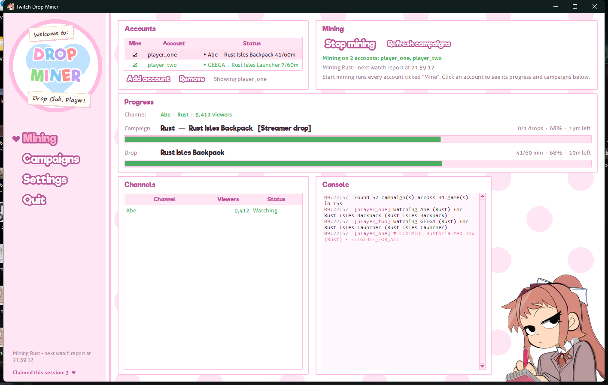
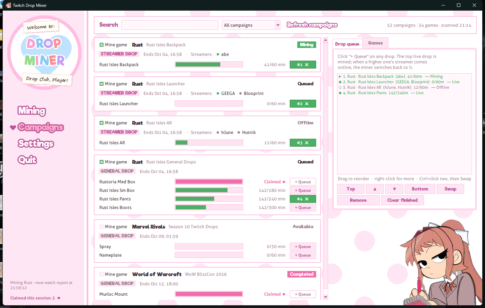
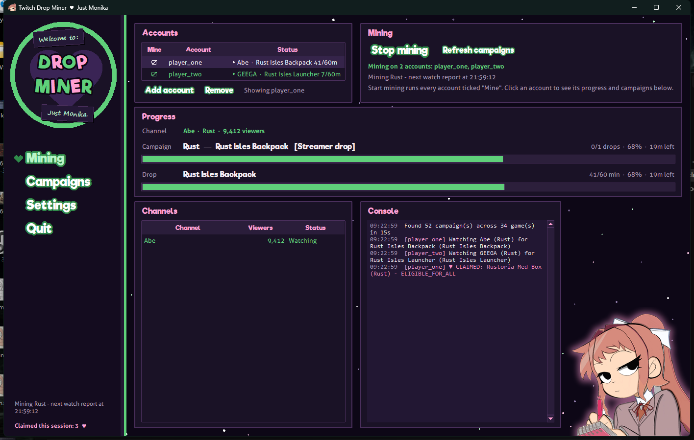

# 💚 Doki Twitch Miner

**Earns Twitch drops for you and claims them automatically**, dressed up like
*Doki Doki Literature Club* — Monika edition.

Pick the campaigns you want, queue specific streamer drops, and let it watch in the
background (no video is downloaded). It can mine on several Twitch accounts at once.



## Features

- **Every live drop campaign on Twitch**, in a searchable list with a progress bar for each drop.
- **Automatic claiming**: finished drops are claimed the moment they complete.
- **Drop queue**: pick exactly which drops to mine, in order. Drag to reorder, or right-click
  a drop to *Move to position* / *Swap with*. If the channels for the top drop are offline,
  the miner moves down the queue, and switches back as soon as a higher one comes online.
- **Streamer drops first**: channel-specific drops (e.g. Rust's streamer drops) are mined
  before general drops. General drops keep progressing on streamer channels anyway.
- **Rust streamer drops** are read from [twitch.facepunch.com](https://twitch.facepunch.com/),
  so you can queue a streamer's drop even while they're offline.
- **Multiple accounts at once**: tick "Mine" on as many accounts as you like. They share one
  campaign scan but keep their own progress and claims.
- **Picks up new campaigns by itself**: Twitch is rescanned regularly, and newly started
  campaigns for your games are mined automatically.
- **Two themes**: *Doki Doki* (pink polka dots) and *Just Monika* (her starry space room).
- **Optional start with Windows**, minimized, mining straight away.



## Download and run

1. Go to [**Releases**](../../releases) and download **`DokiTwitchMiner.exe`**.
2. Double-click it. Nothing to install.
   - The .exe isn't code-signed, so Windows SmartScreen may say *"Windows protected your PC"*:
     click **More info → Run anyway**.
   - Some antivirus programs flag PyInstaller apps by mistake. The full source is in this repo
     if you'd rather [run or build it yourself](#run-from-source).
3. On first launch it downloads its fonts (a few seconds). Until then it uses Windows fonts.

## Getting started

1. **Add account** (Mining page). Your browser opens `twitch.tv/activate`; confirm the code
   shown in the app. Repeat to add more accounts.
2. Open **Campaigns** and either
   - click **+ Queue** on the drops you want (the order is the mining order), or
   - tick **Mine game** to mine all of a game's campaigns.
3. Click **Start mining**. Progress bars fill up, and drops are claimed automatically.

Make sure each game's account is linked on
[twitch.tv/drops/campaigns](https://www.twitch.tv/drops/campaigns), or Twitch won't count any progress.



## Troubleshooting

| Problem | Fix |
|---|---|
| A red banner says watch time isn't reaching Twitch | Your DNS blocks `spade.twitch.tv`, which is where Twitch counts watch time. In Mullvad, turn off **both** the *Ads* and *Trackers* DNS content blockers; Pi-hole / AdGuard need it allow-listed. |
| A campaign shows *Not progressing* | No progress for 8 minutes, usually because the game account isn't linked. Link it, then click **Refresh campaigns**. |
| A streamer drop shows *Not started* | The streamer is live, but Twitch hasn't switched their drop on yet. It's retried on every rescan. |
| Where are my settings? | `%APPDATA%\TwitchDropClaimer\` (settings, saved logins, downloaded fonts). |

## Run from source

Needs **Python 3.10+** on Windows; only the standard library is used.

```powershell
python twitch_drop_claimer.py
```

`Start.bat` launches it without a console window, and `Create Shortcut.ps1` makes Desktop and
Start-menu shortcuts with the app icon.

### Build the .exe

```powershell
powershell -ExecutionPolicy Bypass -File build.ps1
```

This creates `dist\DokiTwitchMiner.exe` with [PyInstaller](https://pyinstaller.org), in a
separate virtual environment.

## Notes

- **Use at your own risk.** Watching streams automatically isn't something Twitch officially
  allows, so there is some risk to your account, and more with several accounts from one PC.
- Not affiliated with, or endorsed by, **Twitch** or **Team Salvato**. *Doki Doki Literature
  Club* is © Team Salvato; this is an unofficial fan project.
- Fonts aren't bundled: [Riffic Free](https://www.dafont.com/riffic.font) (Inkyotter, free for
  personal use) and [Aller](https://www.fontsquirrel.com/fonts/aller) (Dalton Maag) are
  downloaded from their official pages on first launch, under their own licences.
- Monika illustration used with permission.
- Inspired by [DevilXD/TwitchDropsMiner](https://github.com/DevilXD/TwitchDropsMiner).
